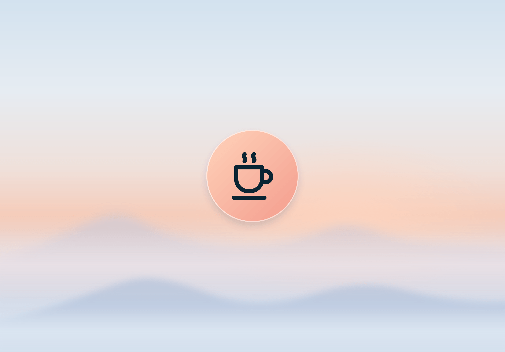

<p align="center">
  
</p>

<h1 align="center">Ready2Order Kitchen</h1>

<p align="center">
  A kitchen display for <a href="https://ready2order.com">ready2order</a>: every open order on one screen, tap an item when it is done.
</p>

---

## Features

- **Kitchen view.** Open orders appear as one card per table, with a ring on each item that fills up as the order waits.
- **To-go orders.** Takeaway orders are highlighted and start to pulse after 15 minutes.
- **Tap to complete.** Tap an item to mark it done. Finished items move into a collapsible *Completed* section.
- **Product group filter.** A drinks station only sees drinks, the kitchen only sees food.
- **Coupons.** Search coupons and show them as barcodes, or copy the code.
- **Languages.** English, German and Russian. The browser language is used by default and can be changed in the settings.
- **Installable.** A PWA with an icon and launch screens for iPhone and iPad. It also runs on older iPads with iOS 12.

## How it works

```
ready2order API  ──►  Node/Express server  ──►  React app (tablet in the kitchen)
                      polls every 15s,
                      stores status in ./data
```

The server pulls orders, invoices and products from the ready2order API on a schedule and keeps the done/open status locally. The app polls the server, so any number of screens stay in sync.

## Getting started

### Prerequisites

- [Node.js](https://nodejs.org) 22 or newer
- A ready2order API authorization key

### Configure

Open [`src/server/config.js`](src/server/config.js) and set at least:

| Setting | Description |
| --- | --- |
| `authorizationKey` | Your ready2order API key |
| `port` | Port of the server, `8080` by default |
| `useTrainingData` | `true` reads ready2order's training/test data, set it to `false` for real orders |
| `fetch.orderCron` | How often orders are fetched, every 15 seconds by default |

### Run

```sh
# Build the app and copy it into the server
cd src/client
npm install
npm run build
npm run deploy        # on Windows: npm run deployW

# Start the server
cd ../..
npm install
npm start
```

Then open `http://localhost:8080` on the kitchen tablet. On an iPad, use *Share › Add to Home Screen* to run it full screen.

## Development

Run the server and the Vite dev server side by side. The dev server forwards `/api` to `localhost:8080`.

```sh
npm start                      # in the base directory
cd src/client && npm run dev   # http://localhost:5173
```

| Command (in `src/client`) | Description |
| --- | --- |
| `npm run dev` | Dev server with hot reload |
| `npm run build` | Production build into `dist/` |
| `npm run lint` | Lint with oxlint |
| `npm run icons` | Render the app icon and favicon from [`scripts/icon.svg`](src/client/scripts/icon.svg) |
| `npm run splash` | Render the iOS launch screens from the icon and [`public/background.svg`](src/client/public/background.svg) |

Translations live in [`src/server/translations.json`](src/server/translations.json).
